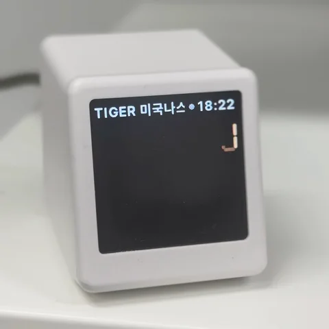

# geekmagic-krx-ticker

GeekMagic SmallTV Ultra(ESP8266) 용 국내 주식 시세 표시기 펌웨어.



- 종목명 / 장 상태 점 / 시계
- 현재가 (7-세그먼트, 일의 자리부터 촤라락 올라가는 갱신 효과)
- 전일 대비 증감 · 등락률 (상승 빨강, 하락 파랑)
- 당일 차트 (시가 기준선 위/아래 색 분리, 시간 순서로 그려짐)
- 정규장 마감 후에는 NXT 애프터마켓 가격으로 표시
- 여러 종목 로테이션, 긴 종목명은 마키
- 웹 설정 페이지 (Wi-Fi, 종목 코드 + 종목명 확인, 간격, 밝기, 관리 비밀번호, 초기화), 웹 OTA 업데이트

## 하드웨어

- GeekMagic SmallTV Ultra (ESP8266 / ESP-12, 4MB 플래시)
- 240×240 ST7789, 하드웨어 SPI (MOSI=GPIO13, SCLK=GPIO14), CS 없음, DC=GPIO0, RST=GPIO2, 백라이트=GPIO5(LOW=켜짐)
- USB-C 는 전원 전용. 펌웨어는 웹 OTA 로만 올린다

## 설치

1. 공장 펌웨어의 웹 업데이트 페이지에서 `geekmagic-krx-ticker.ino.bin` 을 올린다
2. 재부팅하면 화면에 "Wi-Fi 설정 필요" 안내가 뜬다
3. 폰이나 PC 로 `GeekStock` Wi-Fi(비밀번호 없음)에 접속하면 설정 페이지가 열린다
   (안 열리면 브라우저로 `http://192.168.4.1/settings`)
4. 집 Wi-Fi(2.4GHz, WPA2)와 종목 코드를 넣고 저장하면 재시작해서 시세를 표시한다

설정은 펌웨어를 업데이트해도 유지된다. 같은 Wi-Fi 를 다른 사람과 같이 쓰면
설정 페이지에서 관리 비밀번호를 정해 두는 게 좋다 (설정·업데이트 페이지 보호, 사용자 이름 `admin`).

## 빌드

`arduino-cli` + ESP8266 코어 3.1.2

```sh
arduino-cli config add board_manager.additional_urls https://arduino.esp8266.com/stable/package_esp8266com_index.json
arduino-cli core install esp8266:esp8266
arduino-cli lib install "Adafruit GFX Library" "Adafruit ST7735 and ST7789 Library" ArduinoJson
```

Arduino 스케치 규칙상 폴더 이름과 `.ino` 이름이 같아야 한다 (`geekmagic-krx-ticker/geekmagic-krx-ticker.ino`).

```sh
git clone https://github.com/heyzzung/geekmagic-krx-ticker.git
cd geekmagic-krx-ticker
arduino-cli compile --fqbn esp8266:esp8266:generic:eesz=4M1M --output-dir build .
```

확인한 라이브러리 버전: Adafruit GFX 1.13.0, Adafruit ST7735 and ST7789 1.12.0, ArduinoJson 7.4.3

## 업로드 (OTA)

브라우저로 `http://<기기IP>/update` 에 `build/geekmagic-krx-ticker.ino.bin` 을 올리거나:

```sh
curl -F "firmware=@build/geekmagic-krx-ticker.ino.bin" http://<기기IP>/update
# 관리 비밀번호를 정했으면: curl -u admin:<비밀번호> -F ...
```

기기 주소는 `http://geekstock.local/` (mDNS) 로도 접속된다.

## 사용

- `/` 상태 (펌웨어 버전, heap, 부팅 원인, 마지막 크래시 주소)
- `/settings` Wi-Fi · 종목 코드(쉼표 구분, 최대 10개) · 전환 간격 · 갱신 주기 · 밝기 · 관리 비밀번호 · 설정 초기화
- `/quotes` 받은 시세 표
- Wi-Fi 정보가 없거나 연결에 실패하면 `GeekStock` Wi-Fi(비밀번호 없음)를 띄우고 화면에 접속 방법을 표시
- 복구 모드: 전원을 빠르게 3번 껐다 켜거나 부팅 직후 크래시가 반복되면 `GeekStock` Wi-Fi + OTA 만 동작.
  접속 후 `http://192.168.4.1/update` 로 펌웨어를 다시 올린다 (저장된 설정은 그대로)

## 장 시간

- 정규장: 평일 09:00~15:30 (확정 종가용으로 15:40 까지 요청)
- NXT 애프터마켓: 평일 15:30~20:00 (20:10 까지 요청), 이 시간대에는 NXT 가격 표시
- 그 외 시간·주말에는 요청하지 않고 저장된 값으로 로테이션만

## 데이터 출처

네이버 증권의 비공식 API 를 사용한다. 예고 없이 바뀌거나 막힐 수 있다.

- 시세: `polling.finance.naver.com/api/realtime/domestic/stock/<코드,...>`
- 분봉: `api.stock.naver.com/chart/domestic/item/<코드>/minute`

## 폰트

`font_kr.h` 는 [Pretendard](https://github.com/orioncactus/pretendard) Bold 22px 에서 `tools/gen_font.py` 로 생성한 비트맵 (KS X 1001 한글 2,350자 + ASCII). Pretendard 는 SIL Open Font License 1.1 — `tools/Pretendard-LICENSE.txt`.

## 라이선스

MIT — `LICENSE`. 단, `font_kr.h` 와 Pretendard 폰트는 SIL Open Font License 1.1 을 따른다.
